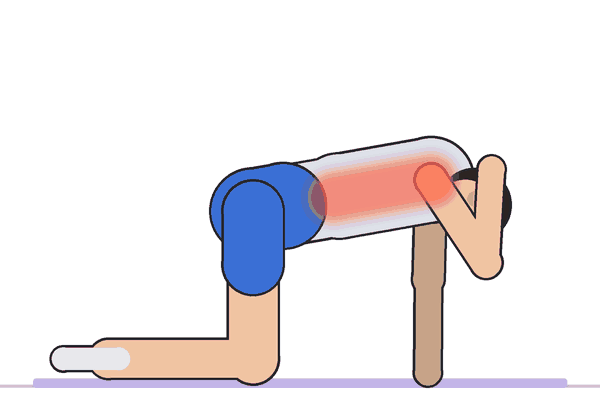

# Brustwirbelsäulen-Rotation

> Vierfüßlerstand, Hand an den Hinterkopf. Ellbogen nach unten, dann weit nach oben aufdrehen, Blick folgt.

- **Muskeln/Bereich:** Brustwirbelsäule
- **Equipment:** Körpergewicht
- **Kategorie:** Mobility
- **Erfassung:** Sekunden (Halten)

## Ausführung

- Vierfüßlerstand, Hüfte bleibt über den Knien, die Stützhand unter der Schulter.
- Freie Hand an den Hinterkopf, Ellbogen zeigt zur Seite.
- Ellbogen unter dem Körper Richtung Stützarm führen.
- Dann den Ellbogen weit zur Decke aufdrehen, Blick folgt.
- Die Drehung kommt aus dem Brustkorb, nicht aus der Lendenwirbelsäule.

## Häufige Fehler

- Hüfte schiebt zur Seite oder nach hinten.
- Den Kopf in den Nacken reißen.

## Atmung

Einatmen beim Aufdrehen, ausatmen beim Einrollen.

## Wo du es spürst

Bewegung zwischen den Schulterblättern.

## Kommt vor in

- [Mobility-Routine](../ablaeufe/gefuehrt/mob.md)
- [Mobility nach Gefühl: Schultern und Brust](../mobility/koerperbereiche.md)
- [Mobility nach Gefühl: Oberer Rücken](../mobility/koerperbereiche.md)
- [Yoga nach Gefühl](../mobility/yoga-baukasten.md)
- [Skill Brücke (Rad), Stufe 3](../skills/bruecke.md)
- [Skill Schulterbeweglichkeit, Stufe 3](../skills/schulter.md)
- [Skill Überkopf-Kniebeuge, Stufe 2](../skills/ohs.md)
