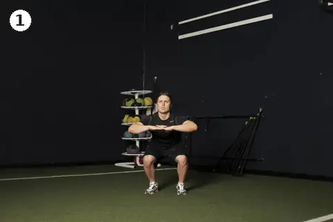

# Hocksprünge

> Explosiv springen und die Knie zur Brust ziehen. Weich landen.

- **Muskeln/Bereich:** Schnellkraft, Kondition
- **Equipment:** Körpergewicht, Calisthenics
- **Kategorie:** Kondition
- **Erfassung:** Sekunden (Halten)

## Kommt vor in

- [Vorlage Bein-HIIT](../ablaeufe/vorlagen/x-hiit.md)
