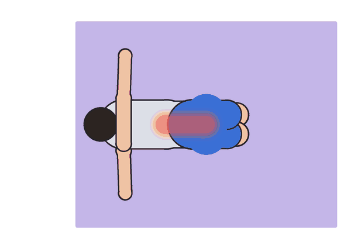

# Liegende Drehung

> Auf dem Rücken, Arme zur Seite. Knie zu einer Seite sinken lassen, Schultern bleiben am Boden.

- **Muskeln/Bereich:** Wirbelsäule, Po
- **Equipment:** Körpergewicht
- **Kategorie:** Mobility
- **Erfassung:** Sekunden (Halten)

## Ausführung

- Auf dem Rücken, Arme in T-Form, Handflächen nach oben.
- Knie angewinkelt zusammen, langsam zu einer Seite sinken lassen.
- Beide Schulterblätter bleiben am Boden, sonst Knie auf ein Kissen.
- Kopf dreht optional zur Gegenseite.

## Häufige Fehler

- Die obere Schulter hebt ab.
- Die Knie mit Kraft nach unten drücken.

## Atmung

In die oben liegende Flanke und Brust atmen. Jedes Ausatmen lässt die Knie schwerer werden.

## Wo du es spürst

Sanfte Drehung in der Wirbelsäule, Dehnung an Po und Brust.

## Kommt vor in

- [Yoga-Flow · 20 min](../ablaeufe/gefuehrt/yoga20.md)
- [Yoga · 30 min](../ablaeufe/gefuehrt/yoga30.md)
- [Mobility nach Gefühl: Oberer Rücken](../mobility/koerperbereiche.md)
- [Mobility nach Gefühl: Unterer Rücken](../mobility/koerperbereiche.md)
- [Mobility nach Gefühl: Po](../mobility/koerperbereiche.md)
- [Yoga nach Gefühl](../mobility/yoga-baukasten.md)
