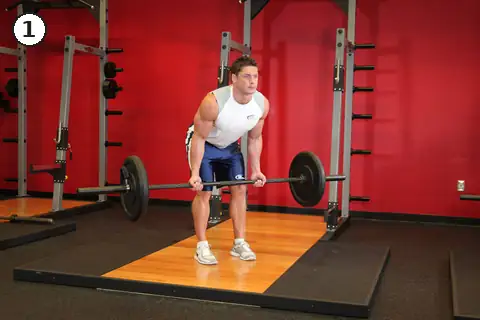

# Rudern im Untergriff

> Untergriff schulterbreit, Oberkörper ca. 45° vorgebeugt. Stange zum Bauchnabel, Ellbogen eng am Körper.

- **Muskeln/Bereich:** Lat, Bizeps
- **Equipment:** Langhantel
- **Kategorie:** Rücken
- **Erfassung:** Gewicht und Wiederholungen, Steigerung 2.5 kg
- **Hantel:** Langhantel
