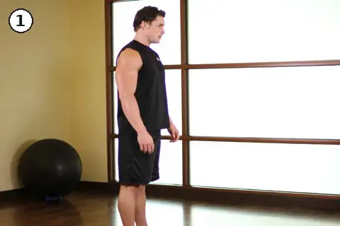

# Oberer Rücken rund

> Hände vor der Brust verschränken, Arme nach vorn schieben, Rücken rund machen.

- **Muskeln/Bereich:** Oberer Rücken
- **Equipment:** Körpergewicht
- **Kategorie:** Mobility
- **Erfassung:** Sekunden (Halten)

## Kommt vor in

- [Mobility nach Gefühl: Oberer Rücken](../mobility/koerperbereiche.md)
