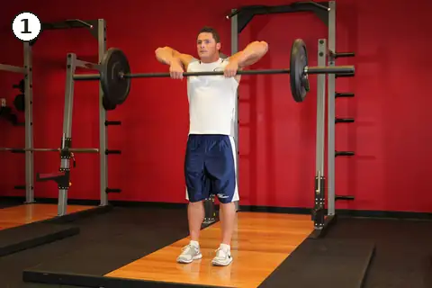

# Aufrechtes Rudern

> Griff etwas breiter als schulterbreit, Ellbogen führen, nur bis Brusthöhe ziehen.

- **Muskeln/Bereich:** Schultern, Trapez
- **Equipment:** SZ-Stange
- **Kategorie:** Schultern
- **Erfassung:** Gewicht und Wiederholungen, Steigerung 2.5 kg
- **Hantel:** SZ-Stange
