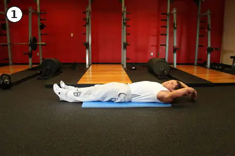

# V-Ups

> Aus der Rückenlage gestreckte Arme und Beine gleichzeitig heben, Hände zu den Füßen.

- **Muskeln/Bereich:** Core
- **Equipment:** Körpergewicht, Calisthenics
- **Kategorie:** Core
- **Erfassung:** Körpergewicht, Wiederholungen

## Kommt vor in

- [Skill L-Sit, Stufe 5](../skills/lsit.md)
