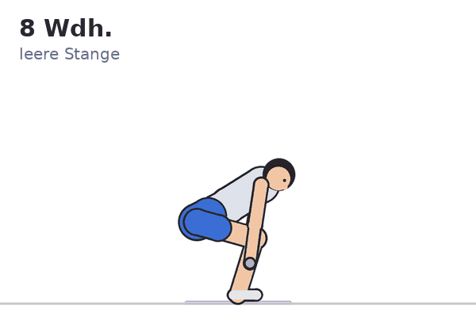

# Aufwärmsätze

> Erste Übung des Tages: 8 Wdh. mit leerer Stange, 5 Wdh. mit ca. 50 %, 3 Wdh. mit ca. 75 % vom Arbeitsgewicht. Locker, kein Satz bis an die Grenze.

- **Muskeln/Bereich:** Technik, Gelenke
- **Erfassung:** Sekunden (Halten)

## Kommt vor in

- [Einstieg](../ablaeufe/gefuehrt/warmup.md)
