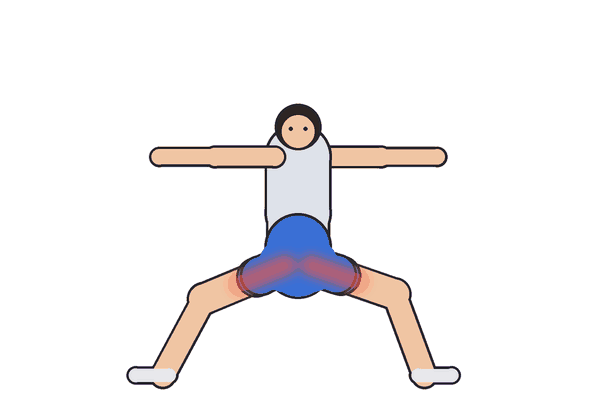

# Krieger II + umgekehrter Krieger

> Vorderes Knie über der Ferse, Arme lang. Dann vorderen Arm nach hinten oben, hintere Hand gleitet am Bein entlang.

- **Muskeln/Bereich:** Beine, Hüfte, Flanke
- **Equipment:** Körpergewicht
- **Kategorie:** Mobility
- **Erfassung:** Sekunden (Halten)

## Ausführung

- Füße weit auseinander, vorderer Fuß zeigt nach vorn, hinterer leicht nach innen gedreht.
- Vorderes Knie beugen, bis es über der Ferse steht und Richtung kleiner Zeh zeigt.
- Becken und Brust zeigen zur Seite, Oberkörper mittig über dem Becken.
- Arme auf Schulterhöhe lang, Schultern tief, Blick über die vordere Hand.
- Umgekehrter Krieger: vorderen Arm nach hinten oben, das Knie bleibt gebeugt.

## Häufige Fehler

- Knie fällt nach innen.
- Oberkörper lehnt nach vorn über das gebeugte Bein.
- Außenkante des hinteren Fußes hebt ab.

## Atmung

Gleichmäßig weiteratmen. Im umgekehrten Krieger in die gestreckte Flanke einatmen.

## Wo du es spürst

Arbeit im vorderen Oberschenkel, Öffnung in Leiste und Flanke.

## Kommt vor in

- [Yoga-Flow · 20 min](../ablaeufe/gefuehrt/yoga20.md)
- [Yoga · 30 min](../ablaeufe/gefuehrt/yoga30.md)
- [Yoga nach Gefühl](../mobility/yoga-baukasten.md)
