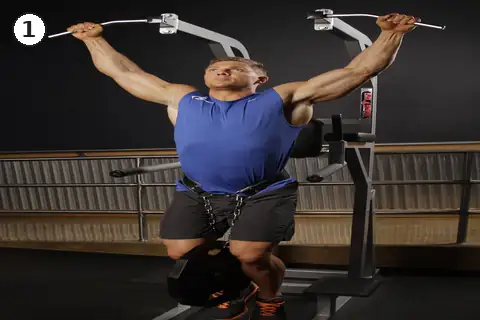

# Klimmzüge mit Zusatzgewicht

> Kurzhantel zwischen den Füßen oder Rucksack. Erst ab 10 sauberen Wiederholungen.

- **Muskeln/Bereich:** Rücken, Bizeps
- **Equipment:** Klimmzugstange, Kurzhanteln
- **Kategorie:** Rücken
- **Erfassung:** Gewicht und Wiederholungen, Steigerung 1 kg
- **Braucht die Klimmzugstange**

## Kommt vor in

- [Skill Klimmzug, Stufe 6](../skills/klimmzug.md)
