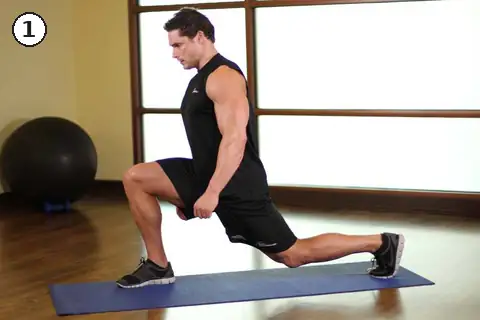
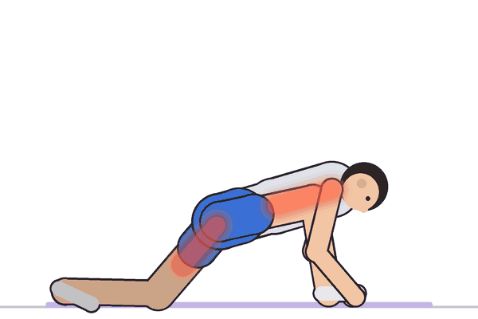

# World's Greatest Stretch

> Tiefer Ausfallschritt, Ellbogen zum Fuß, dann Arm zur Decke aufdrehen.

- **Muskeln/Bereich:** Hüfte, Brustwirbelsäule
- **Equipment:** Körpergewicht
- **Kategorie:** Mobility
- **Erfassung:** Sekunden (Halten)

## Ausführung

- Großer Ausfallschritt, vorderer Fuß komplett neben der gleichseitigen Hand.
- Hinteres Bein lang und aktiv, Ferse schiebt nach hinten.
- Ellbogen innen am vorderen Fuß Richtung Boden sinken lassen, Brust bleibt lang.
- Dann den Arm zur Decke aufdrehen, Blick folgt der Hand.
- Vorderes Knie bleibt über dem Sprunggelenk und kippt nicht nach innen.

## Häufige Fehler

- Schritt zu kurz, das vordere Knie schiebt weit über die Zehen.
- Beim Aufdrehen nur den Arm bewegen statt den Brustkorb.
- Hüfte des hinteren Beins sackt durch.

## Atmung

Ausatmen, wenn der Ellbogen sinkt. Einatmen beim Aufdrehen.

## Wo du es spürst

Hüftbeuger hinten, Leiste vorn, Drehung im oberen Rücken.

## Kommt vor in

- [Einstieg](../ablaeufe/gefuehrt/warmup.md)
- [Mobility-Routine](../ablaeufe/gefuehrt/mob.md)
- [Mobility nach Gefühl: Hüfte und Hüftbeuger](../mobility/koerperbereiche.md)
- [Mobility nach Gefühl: Oberschenkel hinten](../mobility/koerperbereiche.md)
- [Yoga nach Gefühl](../mobility/yoga-baukasten.md)
