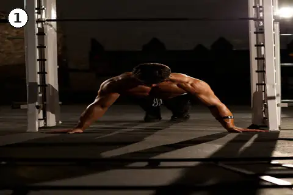

# Weite Liegestütze

> Äußere Griffposition, Körper eine Linie, Brust bis knapp zum Boden.

- **Muskeln/Bereich:** Brust
- **Equipment:** Liegestützbrett, Körpergewicht
- **Kategorie:** Brust
- **Erfassung:** Körpergewicht, Wiederholungen
