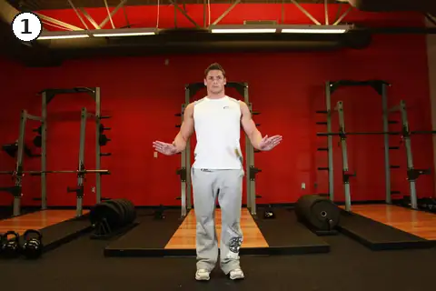

# Handgelenkkreisen

> Hände locker kreisen lassen, beide Richtungen. Vor Liegestützen und Handstand.

- **Muskeln/Bereich:** Handgelenke
- **Equipment:** Körpergewicht
- **Kategorie:** Mobility
- **Erfassung:** Sekunden (Halten)
