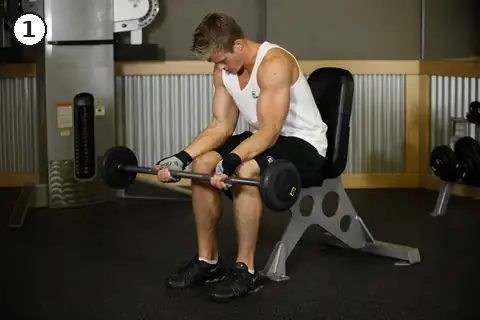

# Handgelenk-Curls

> Unterarme auf den Oberschenkeln, Handgelenke über die Knie. Nur die Hände bewegen.

- **Muskeln/Bereich:** Unterarme
- **Equipment:** SZ-Stange, Bank
- **Kategorie:** Arme
- **Erfassung:** Gewicht und Wiederholungen, Steigerung 2.5 kg
- **Hantel:** SZ-Stange

## Kommt vor in

- [Vorlage Arme und Schultern](../ablaeufe/vorlagen/x-arms.md)
- [Skill Griffkraft, Stufe 2](../skills/griff.md)
