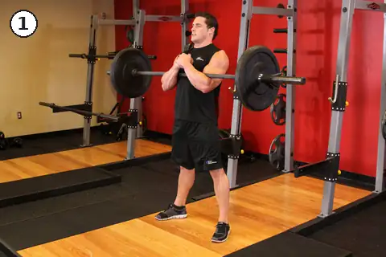

# Zercher-Kniebeuge

> Ohne Ablage: Stange auf die Oberschenkel heben, in die Armbeugen nehmen (Handtuch drumwickeln) und aufstehen. Oberkörper aufrecht, tief beugen.

- **Muskeln/Bereich:** Oberschenkel, Po, Core
- **Equipment:** Langhantel, Unkonventionell
- **Kategorie:** Beine und Po
- **Erfassung:** Gewicht und Wiederholungen, Steigerung 2.5 kg
- **Hantel:** Langhantel

## Kommt vor in

- [Vorlage Langhantel kompakt](../ablaeufe/vorlagen/x-lh.md)
- [Skill Frontkniebeuge, Stufe 2](../skills/frontsq.md)
- [Skill Frontkniebeuge, Stufe 4](../skills/frontsq.md)
