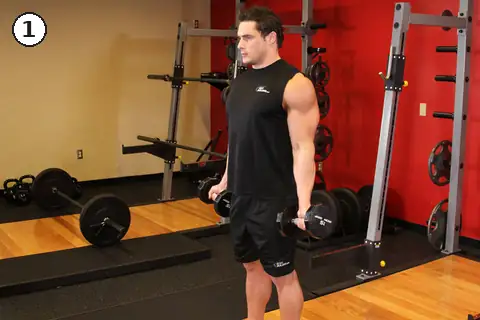

# Zottman Curls

> Hoch im Untergriff, oben drehen, im Obergriff langsam ablassen.

- **Muskeln/Bereich:** Bizeps, Unterarme
- **Equipment:** Kurzhanteln
- **Kategorie:** Arme
- **Erfassung:** Gewicht und Wiederholungen, Steigerung 1 kg
- **Hantel:** zwei Kurzhanteln

## Kommt vor in

- [Vorlage Arme und Schultern](../ablaeufe/vorlagen/x-arms.md)
